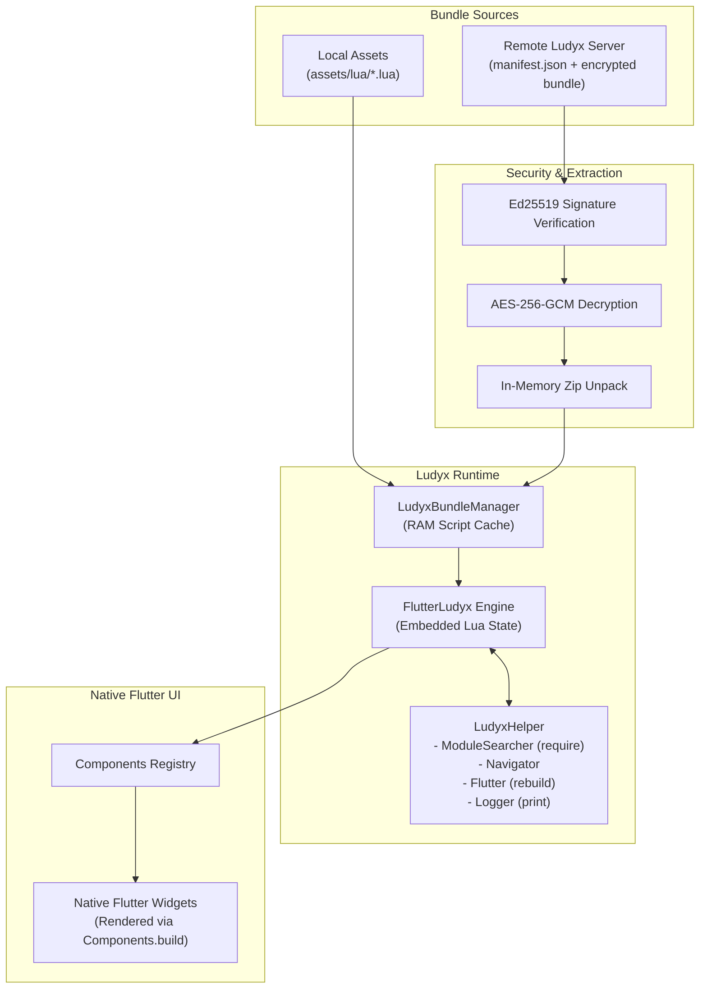

# Flutter Ludyx

[](https://pub.dev/packages/flutter_ludyx)
[](https://opensource.org/licenses/MIT)

**Flutter Ludyx** is a runtime adapter and Server-Driven UI (SDUI) engine for Flutter that enables lightweight mobile applications with **backend-controlled business logic** powered by embedded Lua.

With Flutter Ludyx, you can define your layout, navigation flow, and dynamic business logic in sandboxed Lua scripts while retaining native Flutter rendering performance. Scripts can be bundled within the app or delivered over-the-air (OTA) from a remote Ludyx server with cryptographic verification and encryption.

> [!WARNING]
> This package is actively in development. Contracts, APIs, and syntax are subject to change as the ecosystem matures.

---

## Why Flutter Ludyx?

Traditional Server-Driven UI (SDUI) frameworks rely on rigid, static JSON payloads that can describe UI trees but struggle with dynamic behaviors (form validations, reactive calculations, state mutations, and event handlers) without complex, custom domain-specific languages (DSLs).

**Flutter Ludyx bridges this gap:**
- **Dynamic Logic in Lua:** Write real programmatic logic, loops, conditional rendering, and state management in fast, lightweight Lua.
- **Native Flutter Performance:** Flutter renders your actual native widgets (`Text`, `Row`, `Column`, custom design systems) rather than emulating web views.
- **Over-The-Air (OTA) Updates:** Update app screens, routes, and behavior instantly without waiting for App Store or Google Play approval cycles.
- **Enterprise-Grade Security:** Bundles delivered from remote servers are cryptographically signed with **Ed25519** and encrypted with **AES-256-GCM**.

---

## Features

- ⚡ **Backend-Controlled Logic & SDUI**: Drive UI composition and business logic remotely.
- 🔒 **Secure Remote Bundles**: Verified with **Ed25519** signatures and decrypted using **AES-256-GCM** before in-memory execution.
- 📦 **Dual Bundle Sources**: Seamlessly load scripts from local assets (`LudyxBundleAssetConfig`) or remote endpoints (`LudyxBundleRemoteConfig`).
- 🛡️ **Sandboxed Runtime**: Strips dangerous Lua standard libraries (`io`, `os`, `debug`, `load`, etc.) by default, with granular whitelist options.
- 🧩 **Modular Lua Resolution**: In-memory module searcher hooks into standard Lua `require('path.module')` syntax.
- 🔄 **Dart ⇄ Lua Interoperability**:
  - `Flutter.rebuild()` for triggering reactive widget updates from Lua.
  - `Navigator.pushNamed()` and `Navigator.pop()` for handling application navigation.
  - First-class function callback bridges (`LudyxFn`) for user interactions (`onClick`, `onTap`).
  - Standard `print(...)` output redirected to Flutter's `debugPrint` or custom logging callbacks.
- 🪄 **Code Generation Ecosystem**: Pairs seamlessly with `flutter_ludyx_annotations` and `flutter_ludyx_generator` for type-safe widget binding and auto-generated Lua type definitions (EmmyLua/LuaLS).

---

## Architecture



---

## Installation

Add `flutter_ludyx` to your Flutter app's `pubspec.yaml`:

```yaml
dependencies:
  flutter:
    sdk: flutter
  flutter_ludyx: ^0.0.6

  # Optional but recommended for code-generation:
  flutter_ludyx_annotations: ^0.0.1

dev_dependencies:
  build_runner: ^2.17.1
  flutter_ludyx_generator: ^0.0.2
```

---

## Quick Start Guide

### 1. Define Components

Define your native widgets and annotate them with `@LudyxComponent`:

```dart
// lib/components/text_widget.dart
import 'package:flutter/material.dart';
import 'package:flutter_ludyx_annotations/flutter_ludyx_annotations.dart';

@LudyxComponent('text')
class TextWidget extends StatelessWidget {
  final String value;
  final Map<String, dynamic>? style;

  const TextWidget({super.key, required this.value, this.style});

  @override
  Widget build(BuildContext context) {
    return Text(
      value,
      style: TextStyle(
        fontSize: (style?['fontSize'] as num?)?.toDouble() ?? 14.0,
      ),
    );
  }
}
```

```dart
// lib/components/clickable_widget.dart
import 'package:flutter/material.dart';
import 'package:flutter_ludyx_annotations/flutter_ludyx_annotations.dart';

@LudyxComponent('clickable')
class ClickableWidget extends StatelessWidget {
  final VoidCallback onClick;
  final Widget child;

  const ClickableWidget({super.key, required this.onClick, required this.child});

  @override
  Widget build(BuildContext context) {
    return GestureDetector(onTap: onClick, child: child);
  }
}
```

Register components in your entry setup:

```dart
// lib/components.dart
import 'package:flutter_ludyx_annotations/flutter_ludyx_annotations.dart';
import 'components.ldx.dart' as ludyx;

@ludyxComponents
void init() {
  ludyx.setup();
}
```

Run code generation to build the adapter registry and Lua definitions:

```bash
dart run build_runner build --delete-conflicting-outputs
```

> **Note:** The generator also produces `assets/lua/components.lua` with full EmmyLua/LuaLS type definitions, providing autocompletion in editors like VS Code and Neovim!

---

### 2. Initialize Bundles in Flutter

Initialize the component registry and load your script bundle:

```dart
// lib/main.dart
import 'package:flutter/material.dart';
import 'package:flutter_ludyx/flutter_ludyx.dart';
import 'package:my_app/components.dart' as components;

final GlobalKey<NavigatorState> navigatorKey = GlobalKey<NavigatorState>();

Future<void> main() async {
  WidgetsFlutterBinding.ensureInitialized();

  // 1. Initialize registered components
  components.init();

  // 2. Load bundle (from assets or remote server)
  final config = LudyxBundleAssetConfig(bundlePath: 'assets/lua');
  await LudyxBundleManager.syncAndLoad(config: config);

  runApp(const MyApp());
}

class MyApp extends StatelessWidget {
  const MyApp({super.key});

  @override
  Widget build(BuildContext context) {
    return MaterialApp(
      navigatorKey: navigatorKey,
      initialRoute: '/home',
      routes: {
        '/home': (_) => const BaseScreen(routeName: '/home'),
        '/detail': (_) => const BaseScreen(routeName: '/detail'),
      },
    );
  }
}
```

---

### 3. Build a Dynamic Screen

Create a dynamic screen that binds Flutter to the Lua runtime:

```dart
class BaseScreen extends StatefulWidget {
  final String routeName;
  const BaseScreen({super.key, required this.routeName});

  @override
  State<BaseScreen> createState() => _BaseScreenState();
}

class _BaseScreenState extends State<BaseScreen> {
  late final FlutterLudyx ludyx;
  late final ValueNotifier<Map<String, dynamic>> component;

  @override
  void initState() {
    super.initState();
    component = ValueNotifier({});
    ludyx = FlutterLudyx();

    // Setup helper bindings (Logger, Navigator, Flutter rebuild, Module require)
    LudyxHelper(ludyx)
        .withModuleSearcher()
        .withLogger()
        .withNavigatorHelper(navigatorKey)
        .withFlutterHelper(_rebuild)
        .setup();

    // Load main script entry point
    ludyx.loadMain('main.lua');
    _rebuild();
  }

  void _rebuild() {
    component.value = ludyx.callFn<Map<String, dynamic>>('GetView', [widget.routeName]) ?? {};
  }

  @override
  Widget build(BuildContext context) {
    return Scaffold(
      body: ValueListenableBuilder<Map<String, dynamic>>(
        valueListenable: component,
        builder: (context, value, _) {
          if (value.isEmpty) return const SizedBox.shrink();
          return SizedBox(
            width: double.infinity,
            child: Components.build(value),
          );
        },
      ),
    );
  }
}
```

---

### 4. Write Lua Scripts

Now implement your screen logic in Lua:

```lua
-- assets/lua/main.lua
local Routes = require('routes')

function GetView(name)
  local route = Routes.get(name)
  return route()
end
```

```lua
-- assets/lua/view/home.lua
local UI = require("components")

local counter = 0

local function HomeView()
  return UI.MultiWidget({
    direction = "vertical",
    crossAlignment = "center",
    alignment = "center",
    spacing = 16,
    children = {
      UI.TextWidget({
        value = "Welcome to Flutter Ludyx!",
        style = { fontSize = 24 }
      }),
      UI.TextWidget({
        value = "Counter: " .. tostring(counter),
        style = { fontSize = 20 }
      }),
      UI.ClickableWidget({
        onClick = function()
          counter = counter + 1
          Flutter.rebuild()
        end,
        child = UI.TextWidget({ value = "Increment Counter" })
      }),
      UI.ClickableWidget({
        onClick = function()
          Navigator.pushNamed("/detail")
        end,
        child = UI.TextWidget({ value = "Go to Details" })
      })
    }
  })
end

return HomeView
```

When the user taps "Increment Counter", Lua increments `counter` and calls `Flutter.rebuild()`. Flutter re-renders the widget tree instantly!

---

## Bundle Configuration

Flutter Ludyx supports two bundle modes via `LudyxBundleConfig`:

### 1. Local Asset Bundle (`LudyxBundleAssetConfig`)
Loads uncompressed `.lua` scripts directly from your app's asset manifest:

```dart
final config = LudyxBundleAssetConfig(
  bundlePath: 'assets/lua',
);
await LudyxBundleManager.syncAndLoad(config: config);
```

Ensure the path is registered in your `pubspec.yaml`:
```yaml
flutter:
  assets:
    - assets/lua/
    - assets/lua/view/
```

### 2. Encrypted Remote Bundle (`LudyxBundleRemoteConfig`)
Downloads, verifies, and decrypts an over-the-air (OTA) bundle from a remote HTTP server:

```dart
final config = LudyxBundleRemoteConfig(
  baseUrl: 'https://cdn.example.com/ludyx',
  publicKey: '<base64-encoded-ed25519-public-key>',
  aesKey: '<base64-encoded-256-bit-aes-key>',
  authorization: 'Bearer <optional-token>',
);
await LudyxBundleManager.syncAndLoad(config: config);
```

#### Remote Manifest Protocol
The server hosts a `manifest.json` at `${baseUrl}/manifest.json`:
```json
{
  "version": "1.0.0",
  "bundleUrl": "/bundles/bundle-1.0.0.bin",
  "signature": "<base64-ed25519-signature-of-encrypted-payload>"
}
```

**Payload structure for `.bin` bundle:**
- `[12 bytes]` IV / Nonce
- `[16 bytes]` AES-GCM Authentication Tag
- `[Remaining bytes]` AES-256-GCM Encrypted Zip archive containing Lua files

If verification fails or the signature does not match, the bundle is rejected, preventing any execution of untrusted scripts.

---

## Helpers & Sandboxing

### Sandboxing Security
By default, `LudyxHelper.setup()` sandboxes the Lua state by removing hazardous standard library globals:
- `io`
- `os`
- `debug`
- `dofile`, `loadfile`, `load`, `loadstring`

To selectively allow specific libraries, pass them into `setup`:
```dart
LudyxHelper(ludyx).setup({'os'}); // Allows 'os', keeps others stripped
```

### Built-in Helpers

| Helper Method | Injected Lua Global | Description |
| :--- | :--- | :--- |
| `withModuleSearcher()` | `package.searchers` | Enables modular `require('module.submodule')` loading directly from in-memory scripts. |
| `withNavigatorHelper(key)` | `Navigator.pushNamed()`, `Navigator.pop()` | Delegates navigation actions directly to Flutter's `NavigatorState`. |
| `withFlutterHelper(onRebuild)` | `Flutter.rebuild()` | Triggers a widget rebuild callback from within Lua. |
| `withLogger([callback])` | `print(...)` | Routes Lua `print()` output to `debugPrint` or a custom logging handler. |
| `withCustomHelper(helper)` | Custom | Allows registering user-defined `BaseLudyxHelper` instances. |

### Creating a Custom Helper

You can expose custom Dart functionality to Lua by extending `BaseLudyxHelper`:

```dart
import 'package:flutter_ludyx/flutter_ludyx.dart';
import 'package:lua_dardo_plus/lua.dart';

class LudyxDeviceHelper extends BaseLudyxHelper {
  LudyxDeviceHelper(super.ludyx);

  @override
  void setup() {
    ludyx.state
      ..createTable(0, 1)
      ..pushString('getPlatform')
      ..pushDartFunction((LuaState state) {
        state.pushString('flutter');
        return 1;
      })
      ..setTable(-3)
      ..setGlobal('Device');
  }
}

// In Flutter:
LudyxHelper(ludyx)
    .withCustomHelper(LudyxDeviceHelper(ludyx))
    .setup();

// In Lua:
-- local platform = Device.getPlatform()
```

---

## Ecosystem

The Ludyx architecture consists of modular packages designed to work together:

| Package | Role |
| :--- | :--- |
| **`flutter_ludyx`** | Core Flutter runtime, bundle manager, security verification, and helper bridges. |
| **`flutter_ludyx_annotations`** | Lightweight annotations (`@LudyxComponent`, `@ludyxComponents`) for component marking. |
| **`flutter_ludyx_generator`** | Build-runner code generator that produces Dart component wrappers and typed Lua definition files. |

---

## Example Project

A complete, runnable example demonstrating component registration, local asset loading, routing, state management, and code generation is located in the [`example/`](file:///Users/herisetiawan/Documents/Projects/Personal/ludyx/packages/flutter_ludyx/example) directory.

To run the example:
```bash
cd example
flutter pub get
dart run build_runner build
flutter run
```

---

## Contributing

Contributions, feedback, and issue reports are welcome! Please open an issue or pull request on [GitHub](https://github.com/herisetiawan00/flutter_ludyx).

---

## License

This project is licensed under the MIT License - see the [LICENSE](file:///Users/herisetiawan/Documents/Projects/Personal/ludyx/packages/flutter_ludyx/LICENSE) file for details.
